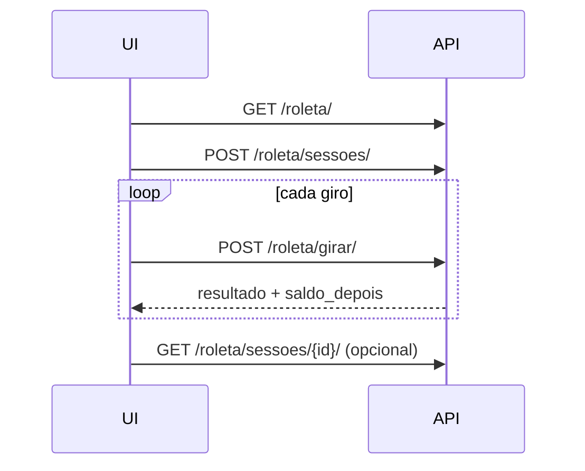

# Contrato — Roleta (PlayHub)

API de **roleta europeia (0–36)** com fichas demo. Sem dinheiro real.

**Base URL:** `{API}/api/v1/roleta/`

---

## 0. Card na grade (jogo `roleta-brasil`)

O card **Roleta Brasil** na home vem de `GET /api/v1/home/` com `play.kind === "roleta"`.

| Campo no `Game` | Banco | Valor seed |
|-----------------|-------|------------|
| `play_kind` | `playhub_game.play_kind` | `roleta` |
| `play_mesa_slug` | `playhub_game.play_mesa_slug` | `roleta-brasil` |

### `GET /api/v1/games/roleta-brasil/`

Agrega vitrine + links da API + config da mesa.

**200 OK**

```json
{
  "card": {
    "id": "roleta-brasil",
    "title": "Roleta Brasil",
    "provider": "Evolution",
    "category": "ao-vivo",
    "badge": "hot",
    "gradient": ["#065f46", "#047857"],
    "icon": "🎡",
    "play": {
      "kind": "roleta",
      "mesa_slug": "roleta-brasil",
      "client_route": "#/roleta",
      "api": {
        "config": "/api/v1/roleta/?mesa=roleta-brasil",
        "sessoes": "/api/v1/roleta/sessoes/",
        "girar": "/api/v1/roleta/girar/",
        "card": "/api/v1/games/roleta-brasil/"
      }
    }
  },
  "play": { "...": "mesmo objeto play acima" },
  "roleta": { "...": "payload de GET /api/v1/roleta/ sem historico ou com mesa" }
}
```

Demais jogos: `play` é `null` e `GET /api/v1/games/{slug}/` não inclui chave `roleta`.

---

## 1. Configuração e histórico

### `GET /api/v1/roleta/`

Query opcional: `?mesa=roleta-brasil` (slug da mesa).

**200 OK**

```json
{
  "mesa": {
    "slug": "roleta-brasil",
    "nome": "Roleta Brasil",
    "variante": "european",
    "saldo_inicial": "1000.00",
    "aposta_minima": "1.00",
    "aposta_maxima": "500.00",
    "max_apostas_por_giro": 12
  },
  "tipos_aposta": [
    {
      "tipo": "straight",
      "multiplicador": "35",
      "descricao": "Número exato (0–36)",
      "requer_numero": true
    },
    {
      "tipo": "red",
      "multiplicador": "1",
      "descricao": "Vermelho",
      "requer_numero": false
    }
  ],
  "numeros": {
    "min": 0,
    "max": 36,
    "vermelhos": [1, 3, 5, 7, 9, 12, 14, 16, 18, 19, 21, 23, 25, 27, 30, 32, 34, 36]
  },
  "historico_recente": [
    { "numero": 17, "cor": "black", "em": "2026-03-27T14:02:11.123456+00:00" }
  ]
}
```

**Tipos de aposta (`tipo`)**

| `tipo` | Seleção | Multiplicador (sobre a aposta) |
|--------|---------|--------------------------------|
| `straight` | `numero` 0–36 | 35:1 |
| `red` / `black` | — | 1:1 |
| `odd` / `even` | — | 1:1 |
| `low` / `high` | 1–18 / 19–36 | 1:1 |
| `dozen_1` / `dozen_2` / `dozen_3` | — | 2:1 |
| `column_1` / `column_2` / `column_3` | — | 2:1 |

O **0 (verde)** perde em apostas externas (cor, paridade, dúzia, coluna, baixo/alto).

**Pagamento:** `valor * (multiplicador + 1)` se ganhar (ex.: R$ 10 no vermelho que acerta → pagamento `20.00`).

---

## 2. Sessão do jogador

### `POST /api/v1/roleta/sessoes/`

**Body**

```json
{
  "mesa_slug": "roleta-brasil",
  "apelido": "Jogador"
}
```

| Campo | Obrigatório | Descrição |
|-------|-------------|-----------|
| `mesa_slug` | Não | Default: primeira mesa ativa |
| `apelido` | Não | Até 40 caracteres |

**201 Created**

```json
{
  "sessao_id": "550e8400-e29b-41d4-a716-446655440000",
  "apelido": "Jogador",
  "mesa_slug": "roleta-brasil",
  "saldo": "1000.00",
  "ultima_rodada": null
}
```

### `GET /api/v1/roleta/sessoes/{sessao_id}/`

**200 OK** — mesmo formato de sessão acima.

---

## 3. Girar (apostar + sorteio)

### `POST /api/v1/roleta/girar/`

Uma transação atômica: valida saldo, debita apostas, sorteia, credita prêmios, persiste rodada e apostas.

**Body**

```json
{
  "sessao_id": "550e8400-e29b-41d4-a716-446655440000",
  "apostas": [
    { "tipo": "red", "valor": "25.00" },
    { "tipo": "straight", "numero": 17, "valor": "5.00" }
  ]
}
```

| Campo | Obrigatório | Descrição |
|-------|-------------|-----------|
| `sessao_id` | Sim | UUID da sessão |
| `apostas` | Sim | 1…`max_apostas_por_giro` itens |
| `apostas[].tipo` | Sim | Ver tabela acima |
| `apostas[].valor` | Sim | Decimal string; entre mín/máx da mesa |
| `apostas[].numero` | Condicional | Obrigatório se `tipo=straight` |

**201 Created**

```json
{
  "rodada_id": 42,
  "resultado": {
    "numero": 17,
    "cor": "black"
  },
  "totais": {
    "apostado": "30.00",
    "pago": "180.00",
    "lucro_liquido": "150.00"
  },
  "apostas": [
    {
      "tipo": "red",
      "numero": null,
      "valor": "25.00",
      "ganhou": false,
      "pagamento": "0.00"
    },
    {
      "tipo": "straight",
      "numero": 17,
      "valor": "5.00",
      "ganhou": true,
      "pagamento": "180.00"
    }
  ],
  "sessao": {
    "id": "550e8400-e29b-41d4-a716-446655440000",
    "saldo_antes": "1000.00",
    "saldo_depois": "1150.00"
  }
}
```

---

## 4. Erros

**400 Bad Request**

```json
{
  "erro": {
    "codigo": "saldo_insuficiente",
    "mensagem": "Saldo insuficiente. Disponível: 50.00"
  }
}
```

| `codigo` | Quando |
|----------|--------|
| `mesa_indisponivel` | Sem mesa ativa |
| `sessao_invalida` | UUID inexistente |
| `sem_apostas` | Lista vazia |
| `muitas_apostas` | Acima do limite da mesa |
| `tipo_aposta_invalido` | `tipo` desconhecido |
| `valor_invalido` | Valor ≤ 0 ou não numérico |
| `abaixo_minimo` / `acima_maximo` | Fora dos limites |
| `numero_obrigatorio` / `numero_invalido` | Straight |
| `numero_proibido` | `numero` em aposta externa |
| `saldo_insuficiente` | Soma das apostas > saldo |

Validação DRF (campos malformados) → **400** com detalhe padrão do REST framework.

---

## 5. Banco de dados (Django Admin)

| Modelo | Uso |
|--------|-----|
| `RoletaMesa` | Limites, slug, ativação |
| `RoletaSessao` | UUID + saldo demo |
| `RoletaRodada` | Resultado de cada giro |
| `RoletaAposta` | Linhas de aposta |
| `Game` (`play_kind`, `play_mesa_slug`) | Vínculo do **card** com a mesa |

Seed: `python manage.py seed_roleta` e `python manage.py seed_playhub`

---

## 6. Fluxo recomendado (frontend)


